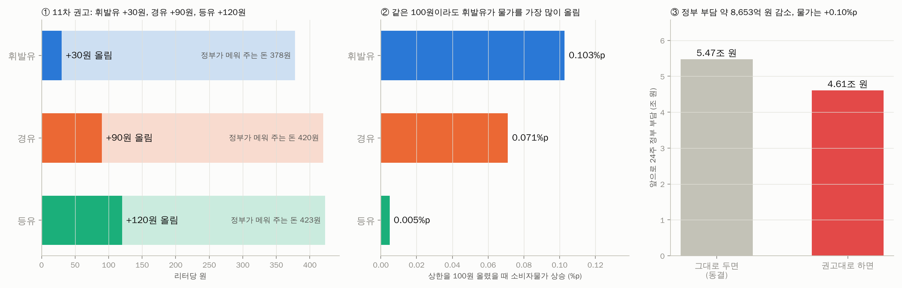

# 석유 최고가격 결정 도우미

산업통상부가 4주마다 정하는 석유 최고가격(휘발유·경유·등유)을 다음 차수(11차)에 몇 원 조정할지,
재정 부담과 물가를 함께 따져 권고하는 도구입니다. 숭실대 경제학과 금융·에너지 데이터 해커톤 출품작.

**11차 권고 (10/10 기준): 휘발유 +30원, 경유 +90원, 등유 +120원**
→ 이번 달 물가 +0.10%p, 앞으로 24주 정부 부담 약 8,620억 원 감소



## 단계

| 단계 | 내용 | 코드 | 핵심 결과 |
|---|---|---|---|
| 1 | 상한제가 없었다면 정유사 공급가 (국제가 3주 + 환율 회귀) | `regression/full_sample/counterfactual.py` | 9월 4주 격차 휘발유 335, 경유 511, 등유 432원 |
| 2 | 재정 부담 = 격차 × 판매량 | `policy/fiscal.py` | 3/13~9/26 누적 6.35조 원 |
| 3 | 상한 조정 → 판매가 → 소비자물가 | `policy/cpi.py` | 3~8월 물가 0.58%p 낮춤 (정부 0.6%p) |
| 4 | 11차 결정 최적화 (국제가·환율 경로 500개 × 행동 216개) | `policy/optimize.py` | 위 권고 |

## 실행

```
pip install pandas numpy matplotlib
echo OPINET_KEY=발급키 > .env          # 오피넷 API 키 (커밋하지 않음)
python regression/full_sample/counterfactual.py
python policy/fiscal.py
python policy/cpi.py
python policy/optimize.py --sensitivity --replay
python policy/plots.py
```

결과는 `results/policy/` 에 저장됩니다. 발표 자료는 `docs/presentation.html` (브라우저로 열기), 자세한 설정과 근거는 `docs/model_design.md`, 프로젝트 규칙은 `CLAUDE.md` 를 보세요.
