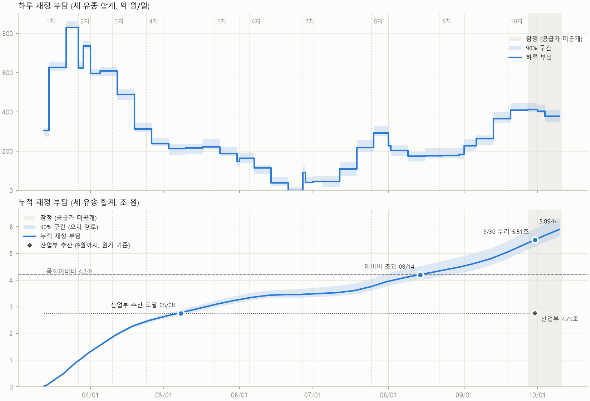

# 2단계 결과: 격차와 재정 부담

"상한제가 없었다면" 세후 공급가(1단계)와 상한의 차이(격차)에 판매량을 곱해 **정부 재정 부담을 휘발유·경유·등유를 합한 하나의 금액으로** 계산했습니다. 기간은 2026-03-13 ~ 2026-10-10(212일)이고, 수치는 2026-10-10 실행 결과입니다.

```
python preprocessing/preprocess_fuel_demand.py   # 페트로넷 출하량 원본 → csv/fuel_sales_monthly.csv
python fiscal/fiscal.py                          # 격차·재정 부담 계산, 산업부 추산과 대조, 그림
```

| 파일 | 내용 |
|---|---|
| `fiscal_daily.csv` | 날마다 세 유종 합계의 판매량·부담·누적 부담(90% 구간). 뒤쪽 열은 계산 근거인 유종별 상한·격차·판매량·부담 |
| `fiscal_weekly.csv` | 주별 부담과 누적 부담(90% 구간), 1리터당 보전액, 잠정 여부 |
| `fiscal_rounds.csv` | 차수별 부담과 누적 부담(90% 구간), 1리터당 보전액 |
| `fiscal_totals.csv` | 전체 합계(90% 구간), 하루 평균, 하루 판매량 |
| `fiscal_ministry_check.csv` | 산업부 추산(격차 100원당 1.5조 원)과의 대조, 누적 부담이 산업부 추산·예비비를 넘는 날 |
| `fiscal.png` | 위 = 하루 재정 부담 (억 원/일), 아래 = 누적 재정 부담 (조 원)과 산업부 추산·목적예비비 |

## 1. 입력 자료와 가정

| 자료 | 파일 | 내용 |
|---|---|---|
| "없었다면" 가격 | `regression/full_sample` (1단계) | 주별 세후 가격과 오차 경로. 최근 2주(9월 5주, 10월 1주)는 공급가 미공개라 국제가로만 추정한 잠정값 |
| 상한 | `csv/price_caps.csv` | 1~10차 상한(세후 공급가 기준)과 시행일. 해커톤 때 보도자료로 입력한 표를 git 기록에서 복원 |
| 판매량 | `csv/fuel_sales_monthly.csv` | 페트로넷 제품별수요(국내출하량), 2025-01 ~ 2026-08, 천 배럴/월 |

- **판매량 단위**는 원본에 적혀 있지 않아 페트로넷 수요 통계의 기본 단위인 천 배럴로 봤습니다. 이 경우 휘발유가 하루 약 26만 배럴로, 국내 소비 규모와 맞습니다.
- 월별 값의 합이 원본 합계 행(휘발유 160,443, 경유 233,395, 등유 21,204)과 같음을 확인했습니다.
- **차량용 경유 비중은 80%(팀 가정)입니다.** 출하량 통계의 경유는 수송·산업·선박용을 합친 값이라, 상한이 걸리는 차량용만 남기려고 80%만 씁니다. 휘발유·등유는 출하량 전체를 씁니다.
- **9·10월 판매량은 아직 발표되지 않았습니다(8월까지 공개).** 그래서 "작년 같은 달 × 올해 흐름"으로 추정했습니다.
  - 올해 흐름 = 2026년 3~8월 출하량 ÷ 2025년 3~8월 출하량 (휘발유 0.965, 경유 0.879, 등유 0.832)
  - 작년 같은 달 값을 그대로 쓰면 합계가 1,435억 원 커집니다.
- 상한이 걸리는 판매량은 세 유종 합계 **하루 평균 약 9,000만 L**입니다(경유 80% 적용).

## 2. 계산 방법

```
격차(유종별, 날마다)  = "없었다면" 세후 공급가(그 주 값) − 그날 상한
하루 재정 부담       = Σ(휘발유·경유·등유) max(격차, 0) × 하루 판매량
                      (하루 판매량 = 월 출하량 ÷ 그 달 일수 × 상한 적용 비중)
누적 재정 부담       = 정책 시행일부터 그날까지 하루 재정 부담의 합
1리터당 보전액       = 하루 재정 부담 ÷ 하루 판매량 (판매량 가중 평균 격차)
```

- **결과는 세 유종을 합한 금액으로 냅니다.** 상한이 유종마다 달라 격차는 유종별로 구한 뒤, 금액으로 바꿔 더합니다. 유종별 계산 근거는 `fiscal_daily.csv` 뒤쪽 열에 남겼습니다.
- **날마다 계산합니다.** 정책이 금요일(3/13)에 시작했고, 상한이 주 중간에 바뀐 날(3/27 인상, 6/27 인하)이 있기 때문입니다.
- **격차가 음수인 날은 부담이 0입니다.** 시장가가 상한보다 낮으면 보전할 것이 없다고 봤습니다.
  - 합계 부담이 0인 날은 6/21 ~ 6/26의 6일입니다.
  - 7차 인하(6/27, −150원) 직전 주라 국제가는 내렸는데 상한은 아직 높았던 때입니다.
- **90% 구간**
  - 1단계 기점 이동 검증의 오차 경로 31개를 정책 기간에 적용해 합계 경로 31개를 만들고, 그 5%·95% 분위수를 씁니다.
  - 같은 기점의 오차를 세 유종에 함께 씁니다. 세 유종의 오차가 같은 국제가 충격에서 나와 함께 움직이기 때문입니다.
  - 주별 오차도 몇 주씩 같은 방향으로 이어지므로(1주 자기상관 0.55~0.68), 주별 구간을 서로 독립인 것처럼 더하면 합계 구간이 실제보다 좁아집니다. 경로를 통째로 더하면 이 문제가 없습니다.

## 3. 자료 점검: 상한 표가 실제 가격과 맞는가

상한이 걸린 주에는 실제 세후 공급가가 상한 바로 아래에 있어야 합니다. 상한이 유종마다 달라 이 점검만 유종별로 합니다.

| | 상한 −10 ~ +1원 안에 든 주 | 벗어난 주와 이유 |
|---|---|---|
| 휘발유 | 26 / 29 | 3/14(+46): 첫 주에 상한이 이틀만 적용됨 · 3/28(−54): 주 중간 인상 · 6/27(−30): 주 중간 인하 |
| 경유 | 24 / 29 | 위 3주 + 7/4(−35), 8/1(−19): 상한이 걸리지 않거나 약하게 걸린 주 |
| 등유 | 26 / 29 | 위 3주 |

벗어난 주가 모두 설명되므로 상한 표는 자료와 맞습니다. 3·5·6·9차 시행일은 추정값이지만, 상한 금액이 앞뒤 차수와 같아 합계에는 영향이 없습니다.

## 4. 결과: 정부 재정 부담 (세 유종 합계)



### 전체 (2026-03-13 ~ 10-10, 212일)

| 재정 부담 합계 | 90% 구간 | 하루 평균 | 1리터당 보전액 |
|---|---|---|---|
| **5조 8,946억 원** | 5조 6,417억 ~ 6조 3,194억 원 | 278억 원 | 308원 |

### 누적 부담이 늘어난 과정

| 시점 | 누적 재정 부담 | 의미 |
|---|---|---|
| 4/09 (2차 끝) | 1.80조 원 | 시행 4주 만에 전체의 30% |
| **5/08** | 2.76조 원 | 산업부가 **9월 말까지**로 추산한 금액에 도달 (90% 구간 5/03 ~ 5/12) |
| **8/14** | 4.2조 원 | **목적예비비 초과** (90% 구간 7/30 ~ 8/27) |
| 9/30 | 5.51조 원 | 산업부 추산(2.76조)의 2.0배 |
| 10/10 | 5.89조 원 | 현재까지 (마지막 2주는 잠정) |

### 차수별

| 차수 | 기간 | 일수 | 부담 (억 원) | 90% 구간 | 1리터당 보전액 | 누적 (조 원) |
|---|---|---|---|---|---|---|
| 1 | 03-13 ~ 03-26 | 14 | 9,147 | 8,969 ~ 9,484 | 667원 | 0.91 |
| 2 | 03-27 ~ 04-09 | 14 | 8,888 | 8,696 ~ 9,190 | 727원 | 1.80 |
| 3 | 04-10 ~ 04-23 | 14 | 6,197 | 5,843 ~ 6,555 | 544원 | 2.42 |
| 4 | 04-24 ~ 05-21 | 28 | 6,392 | 5,980 ~ 7,173 | 274원 | 3.06 |
| 5 | 05-22 ~ 06-04 | 14 | 2,551 | 2,404 ~ 2,967 | 211원 | 3.32 |
| 6 | 06-05 ~ 06-26 | 22 | 1,393 | 1,075 ~ 1,765 | 69원 | 3.46 |
| 7 | 06-27 ~ 07-24 | 28 | 2,777 | 2,209 ~ 3,631 | 100원 | 3.73 |
| 8 | 07-25 ~ 08-21 | 28 | 5,913 | 5,456 ~ 6,712 | 245원 | 4.33 |
| 9 | 08-22 ~ 09-18 | 28 | 6,951 | 6,453 ~ 7,710 | 273원 | 5.02 |
| 10 | 09-19 ~ 10-10 (잠정 포함) | 22 | 8,737 | 8,357 ~ 9,418 | 417원 | 5.89 |

- **부담은 두 번 몰렸습니다.**
  - 3~4월: 국제가 급등기라 하루 부담이 3월 평균 663억 원, 4월 448억 원이었습니다. 1·2차 4주 동안 1.8조 원이 쌓였습니다.
  - 9월 이후: 국제가가 다시 오르며 하루 부담이 9월 평균 335억 원, 10월(잠정 포함) 386억 원으로 늘었습니다.
- **6~7월은 부담이 작았습니다.** 6월 하루 평균 75억 원이고, 6/21 ~ 6/26은 시장가가 상한보다 낮아 0이었습니다.
- **최근 주:** 9월 4주 2,864억 원, 10월 1주(잠정) 2,646억 원. 지금 속도(주 2,600~2,900억 원)라면 한 달에 약 1.2조 원씩 늘어납니다.

## 5. 산업부 추산과 대조

산업부는 "최고가격제를 하지 않았을 때의 추정가격과 최고가격의 차이가 100원이면 정유사 손실보전에 약 1조 5,000억 원이 든다"고 산정했습니다(2026-10-04 보도, 에너지경제연구원 시뮬레이션 기반). 같은 보도에는 다음 내용도 있습니다.
- 2·3분기(9월까지) 원가 기준 손실 추산: 2.76조 원
- 유가 150달러 대비분: 1.5조 원 추가
- 목적예비비: 4.2조 원
- 산업부는 가격 차이가 200원 이상 벌어지지 않을 것을 전제로 했습니다.

보도는 "100원당 1.5조"의 기간을 밝히지 않았습니다. 2·3분기 추산에 정확히 100원분(1.5조)을 더한 구조이므로, **2026-03-13 ~ 09-30(202일)로 가정해** 비교했습니다.

| 3/13 ~ 9/30 (202일) | 산업부 | 우리 |
|---|---|---|
| 격차 100원당 보전액 | 1.50조 원 | 1.82조 원 |
| 이것이 뜻하는 하루 판매량 | 7,430만 L | 9,000만 L (경유 80%) |
| 1리터당 보전액 (판매량 가중 평균 격차) | 184원 (2.76조 ÷ 1.5조 × 100) | 303원 |
| 재정 부담 | 2.76조 원 (원가 기준 추산) | **5.51조 원** (90% 구간 5.26 ~ 5.94조) |
| 우리 평균 격차 × 산업부 단가 | | 4.54조 원 |
| 목적예비비 | 4.2조 원 | 8/14에 초과 (90% 구간 7/30 ~ 8/27) |

차이는 두 가지로 나뉩니다.
1. **판매량:** 산업부 수치가 뜻하는 판매량이 우리보다 18% 적습니다(우리가 21% 많음).
   - 보전 대상이 정유사의 주유소 공급분뿐인지, 차량용 경유 비중이 80%보다 낮은지 등이 원인일 수 있습니다.
   - 경유 비중을 10%p 바꿀 때마다 전체 합계가 약 4,860억 원 달라집니다.
2. **격차 개념:** 산업부 보전은 정유사 **원가 기준** 정산이고, 우리 격차는 **국제 시장가 기준**입니다.
   - 급등기에는 국제 제품가가 정유사 원가보다 훨씬 빨리 오르므로 시장가 기준 격차가 더 큽니다.
   - 근거: 같은 기간 휘발유만 보면 우리 격차(188원)가 산업부가 뜻하는 184원과 거의 같습니다. 차이는 급등 폭이 컸던 경유(399원)·등유(469원)에서 나옵니다.

정리하면 다음과 같습니다.
- 우리 결과는 "상한이 없었다면 시장가로 팔았을 금액" 기준이라, **원가 기준 실제 보전액의 상한에 가깝습니다.**
- 이 기준으로는 **8월 중순에 이미 목적예비비(4.2조 원)를 넘었고**, 9월 말 5.51조 원입니다. 산업부 단가(100원당 1.5조)를 그대로 써도 9월까지 4.54조 원으로 예비비를 넘습니다.
- 실제 보전액은 11월 말 확정되는 정유사별 원가 정산가격에 따라 달라집니다.

## 6. 가정과 한계

| 항목 | 내용 | 영향 |
|---|---|---|
| **차량용 경유 80%** | 팀 가정값이며 출처를 확인하지 않았습니다 | 비중 10%p당 합계 ±4,860억 원. 가장 큰 불확실성 |
| **격차 기준** | 국제 시장가 기준 "없었다면" 가격과 상한의 차이입니다. 실제 보전은 원가 기준 정산입니다 | 급등기에 실제 보전액보다 크게 나옴 (5장) |
| 재정 부담의 정의 | 정부가 정유사에 "(없었다면 − 상한) × 판매량"을 보전하고, 격차가 음수인 날은 0이라는 전제입니다 | 확인 필요 |
| 9·10월 판매량 | 작년 같은 달 × 올해 흐름으로 추정했습니다 | 작년 값을 그대로 쓰면 +1,435억 원. 9월 출하량이 나오면 원본만 바꿔 다시 실행 |
| 잠정 2주 | 9월 5주·10월 1주는 공급가 미공개라 국제가로만 추정했습니다 | 공급가 공개 후 다시 실행 |
| 판매량의 날짜 분포 | 한 달 안에서는 날마다 같다고 봤습니다 | 상한이 바뀐 달의 차수별 배분이 조금 달라질 수 있음 |
| 90% 구간의 범위 | 1단계 모형 오차만 반영합니다. 판매량·경유 비중·상한 자료의 오차와, 정유사가 직전 1년 마진을 유지했을 것이라는 가정은 포함하지 않습니다 | 실제 불확실성은 구간보다 큼 |
| 산업부 대조 기간 | 보도에 기간이 없어 3/13 ~ 9/30으로 가정했습니다 | 기간이 다르면 판매량 비교(5장 1번)가 달라짐 |

## 7. 다음 단계와의 연결

- **3단계(물가 영향)**: 상한 조정폭이 주유소 판매가에 반영되는 비율을 추정합니다. 상한 표(`price_caps.csv`)의 2차(+210원)·7차(−150원)가 자연 실험이 됩니다.
- **4단계(최적화)**: 이 단계의 `daily_burden` 계산을 그대로 쓰되, 미래 국제가 경로와 후보 상한을 넣어 누적 재정 부담을 비교합니다. 예비비(4.2조 원)를 이미 넘었으므로, 남은 기간의 추가 부담 한도와 산업부 전제(격차 200원 이하)를 제약 조건으로 쓸 수 있습니다.

### 출처
- [파이낸셜뉴스, 석유최고가격제 손실보전, 100원 차이에 1.5조 (2026-10-04)](https://www.fnnews.com/news/202610041425171117)
- [뉴스웨이, 정유사 최고가격제 손실보전, 가격차 100원당 1.5조원 산정](https://www.newsway.co.kr/news/view?ud=2026100410260279137)
- [세계일보, 산업부, 석유 최고가격제 격차 100원당 예산 1.5조 산정](https://www.segye.com/newsView/20261004503685)
