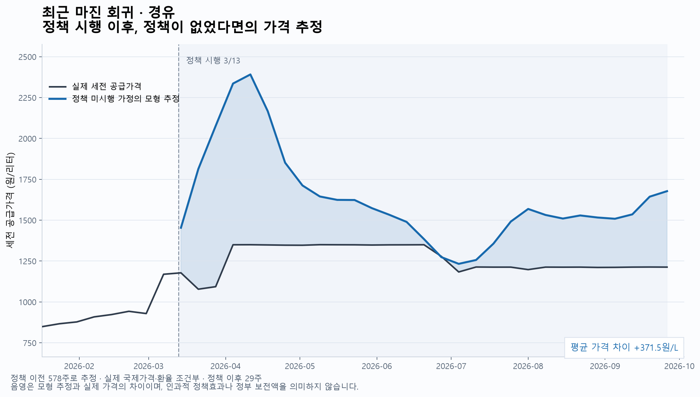
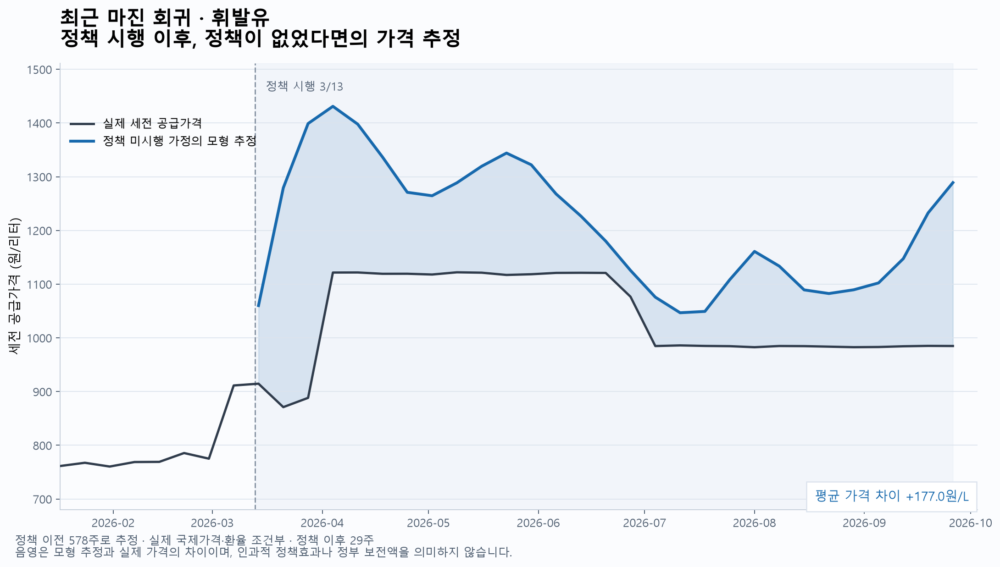
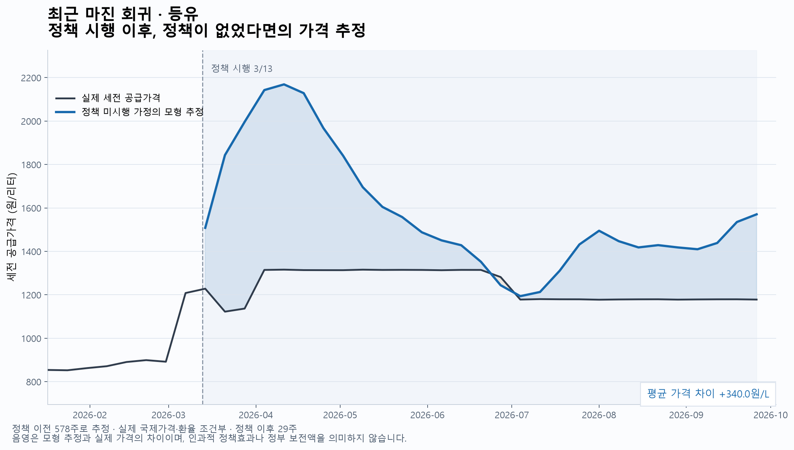
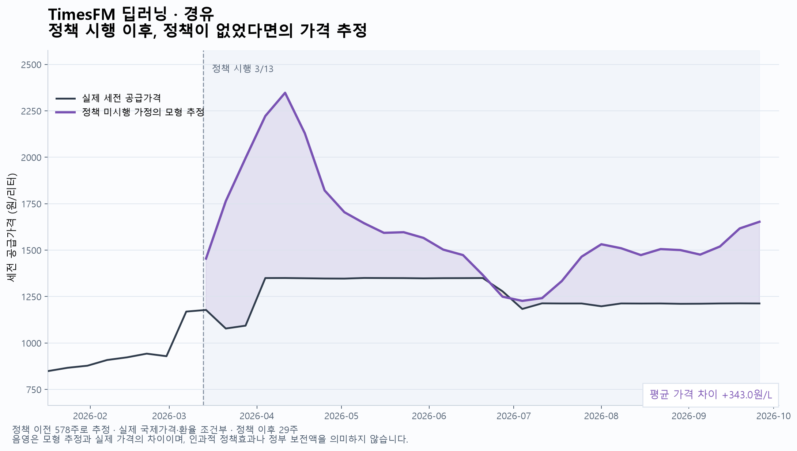
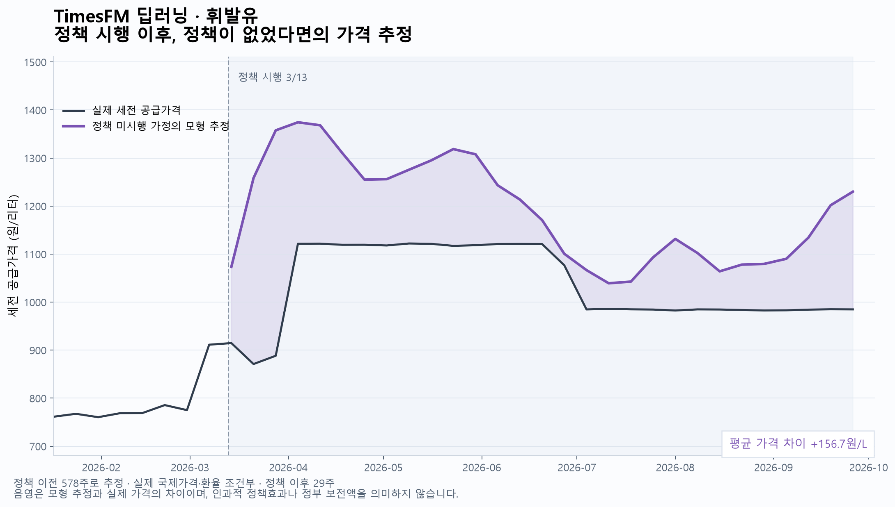
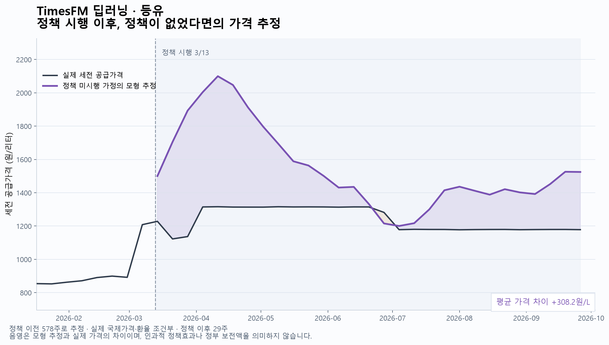

# 정책 미시행 가격 추정: 회귀·딥러닝 그래프 6개

정책 시작일은 2026-03-13, 그래프의 정책 이후 관측 주는 2026-03-14~2026-09-26 (29주)입니다.

## 계산 조건

- 기존 설치 TimesFM 모델과 새 csv/normalized의 train·test·policy 파일 및 scaler JSON을 사용했습니다. 국제가격 3개 시차와 같은 주 환율을 두 모델에 동일하게 제공했습니다.
- 모델 선택을 마친 뒤 정책 이전 전체 578주(train+test)를 합쳐 사용했습니다. 이는 앞 80% 안에서 수행한 이전 교차검증과 다른 최종 정책 시나리오 추정입니다.
- 저장된 표준화를 역변환하고 정책 이전 전체 자료만으로 Z-score를 다시 계산했습니다. 타겟은 원/리터로 유지했고 회귀의 국제가 계수 합 제약은 원래 단위에서 적용했습니다.
- 회귀는 정책 직전까지의 자료로 한 번 적합하고, TimesFM은 같은 가격 이력을 문맥으로 제공합니다. 정책 이후 실제 국내 가격은 학습·문맥에 넣지 않고 비교선으로만 사용했습니다.
- 정책 이후 실제 국제가격·환율은 두 모델의 입력으로 사용했습니다. 따라서 공변량이 알려진 조건부 시나리오입니다. 같은 유종의 두 그래프는 동일한 y축 범위로 표시했습니다.
- 세전 공급가격을 비교합니다. 실제 세금·세후 가격의 정책 미시행 경로를 따로 추정한 것은 아닙니다.
- 모형 관계가 정책이 없을 때에도 유지된다는 가정에 따른 추정입니다. 실제로 관측할 수 없는 미시행 가격의 정답은 없으므로 이를 MAE로 평가하거나 음영을 인과적 정책효과·정부 보전액으로 단정할 수 없습니다. 확률구간은 표시하지 않았습니다.

## 정책 이후 가격 차이 요약

차이 = 모형의 정책 미시행 가격 추정 − 실제 세전 공급가격. 단위는 원/리터입니다.

| 모델 | 유종 | 평균 추정 가격 | 평균 실제 가격 | 평균 차이 | 마지막 주 추정 | 마지막 주 실제 | 마지막 주 차이 |
| --- | --- | ---: | ---: | ---: | ---: | ---: | ---: |
| 최근 마진 회귀 | 경유 | 1631.09 | 1259.63 | 371.45 | 1677.32 | 1212.72 | 464.60 |
| 최근 마진 회귀 | 휘발유 | 1211.07 | 1034.04 | 177.02 | 1288.99 | 984.80 | 304.19 |
| 최근 마진 회귀 | 등유 | 1576.84 | 1236.83 | 340.01 | 1570.57 | 1178.15 | 392.42 |
| TimesFM 딥러닝 | 경유 | 1602.68 | 1259.63 | 343.05 | 1652.58 | 1212.72 | 439.86 |
| TimesFM 딥러닝 | 휘발유 | 1190.74 | 1034.04 | 156.70 | 1229.91 | 984.80 | 245.11 |
| TimesFM 딥러닝 | 등유 | 1544.98 | 1236.83 | 308.15 | 1524.66 | 1178.15 | 346.51 |

## 그래프

### 최근 마진 회귀 · 경유

### 최근 마진 회귀 · 휘발유

### 최근 마진 회귀 · 등유

### TimesFM 딥러닝 · 경유

### TimesFM 딥러닝 · 휘발유

### TimesFM 딥러닝 · 등유

[주별 예측 및 실제 가격](predictions.csv)

사용 모델: `C:\Users\ohobe\OneDrive\Desktop\경제 헤커톤\모델\timesfm-3.0-pytorch`

재실행(PowerShell): `& "../경제 헤커톤/.venv-timesfm/Scripts/python.exe" regression/plot_policy_counterfactual.py`
